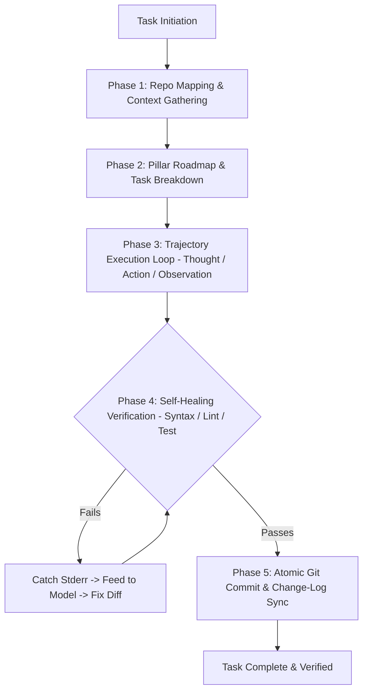

# 🔄 AgenticSync (Universal AI Agent Workflow & Sync Protocol)

`agentic-sync` is an open-source, production-grade skill designed for AI coding agents and human developers. It synthesizes the world's leading agent architectures into a single, cohesive workflow:

1. **Aider's Repository Mapping & Symbol Awareness** (Knowing the whole project without token bloat).
2. **Continuous State & Documentation Synchronization** (Keeping 4 core pillars: Security, CMS/DB, UI/CSS, Logic 100% in sync after every task).
3. **SWE-agent's Trajectory & Observation Feedback Loops** (Reasoning $\rightarrow$ Tool Action $\rightarrow$ Environment Feedback $\rightarrow$ Verification).
4. **Pre-commit Secret Shield & Atomic Git Commits** (Zero-leakage protection and automated version tracking).

---

## 🏗️ The 5-Phase Agentic Execution Cycle



---

## 📌 Phase 1: Repository Mapping (The Aider Model)
- Run `python scripts/generate_repo_map.py` to generate an elided structural map of classes, exported functions, and dependencies.
- Identify the exact files requiring modification.
- Always check `.gitignore` and confirm no credentials or secret keys are tracked.

---

## 📌 Phase 2: Pillar-Based Documentation & Categorization

Every software system naturally divides into four core pillars. Maintain a dedicated document for each under `docs/`:

| Pillar File | Domain & Responsibilities |
| :--- | :--- |
| **`docs/00_MASTER_ROADMAP.md`** | Master backlog, architecture diagram, version milestones (e.g. `v1.0` $\rightarrow$ `v1.1`), and current active sprint. |
| **`docs/01_SECURITY_AND_AUTH.md`** | Credential management, environment variables, authentication, RBAC, API key safety, and vulnerability audits. |
| **`docs/02_DATABASE_AND_CMS.md`** | Schemas, ORM/CMS structure (Sanity, Prisma, PostgreSQL), migrations, seeds, and API projections. |
| **`docs/03_DESIGN_AND_ASSETS.md`** | CSS modularization (tokens, layouts, components), asset folders (favicons, images, branding), and responsive rules. |
| **`docs/04_LOGIC_AND_ARCHITECTURE.md`** | Page routing, business logic, algorithms, state management, and service integrations. |

---

## 📌 Phase 3: Trajectory Execution Loop (The SWE-agent Model)

Follow the strict **Observation-Thought-Action** protocol on every turn:
1. **Observation:** Read the current state of the file, test outputs, or terminal response.
2. **Thought:** Explicitly explain *why* the modification is needed and which edge cases are addressed.
3. **Action:** Apply targeted edits using exact drop-in replacements (`edit_file`) rather than blind file rewriting.

---

## 📌 Phase 4: Self-Healing & Verification (Auto-Lint & Test)

Never claim a task is complete without tool-verified evidence:
- **Syntax & Lint Check:** Run project linters or syntax parsers (e.g., `node -c`, `eslint`, `flake8`, `pytest`).
- **Self-Healing Loop:** If a command fails or an error is thrown in stdout/stderr, immediately capture the error, analyze the stack trace, and apply a corrective patch before reporting to the user.

---

## 📌 Phase 5: Atomic Git Commits & Change-Log Logging

Every task concludes with a two-way synchronization:
1. **Change-Log Entry:** Update the corresponding Pillar file's `Change Log` with:
   - Version tag (e.g., `[v8.2]`)
   - Date timestamp
   - List of modified files with line numbers
   - Summary of problem solved
2. **Git Commit:** Stage only the relevant files and commit with a standard Conventional Commit message:
   ```bash
   git commit -m "feat(security): isolate service credentials and sanitize public queries [v8.2]"
   ```

---

## 🛠️ Helper Tooling in this Skill

- [`scripts/generate_repo_map.py`](file:///c:/Users/USER/Downloads/%23%23aicode/DC-hall%20(sanity)/skills/agentic-sync/scripts/generate_repo_map.py) — Lightweight AST-based repository structure generator.
- [`scripts/verify_changes.py`](file:///c:/Users/USER/Downloads/%23%23aicode/DC-hall%20(sanity)/skills/agentic-sync/scripts/verify_changes.py) — Git diff and change-log linter to ensure docs stay 100% in sync with code.
- [`scripts/install_hook.py`](file:///c:/Users/USER/Downloads/%23%23aicode/DC-hall%20(sanity)/skills/agentic-sync/scripts/install_hook.py) — 1-click git pre-commit hook installer.
- [`references/AIDER_SWE_ARCHITECTURE.md`](file:///c:/Users/USER/Downloads/%23%23aicode/DC-hall%20(sanity)/skills/agentic-sync/references/AIDER_SWE_ARCHITECTURE.md) — Comprehensive reference on Aider PageRank, SWE-agent `.traj` logs, and MetaGPT SOPs.
- [`templates/PILLAR_TEMPLATE.md`](file:///c:/Users/USER/Downloads/%23%23aicode/DC-hall%20(sanity)/skills/agentic-sync/templates/PILLAR_TEMPLATE.md) — Ready-to-use template for new projects.
