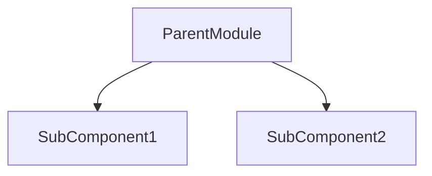

# 📁 [PILLAR_NAME]: [PILLAR_TITLE]

> **File Location:** `docs/[XX]_[PILLAR_NAME].md`  
> **Current Version:** `v1.0`  
> **Last Updated:** [YYYY-MM-DD]  
> **Status:** 🟡 In Progress / 🟢 Healthy / 🔴 Action Required

---

## 🔍 Domain Overview & Responsibilities
[Provide a concise description of what this module covers and why it is separated from other files.]

---

## 🏗️ Architecture & Component Mapping

---

## 📋 Action Items & Sprints
- [ ] **Task 1:** [Description of pending work]
- [ ] **Task 2:** [Description of pending work]
- [x] **Task 3:** [Completed initial audit]

---

## 📝 Change Log & Version History
*Every task modifying this domain MUST append an entry here with version and timestamp.*

- **[v1.0] — [YYYY-MM-DD]:** Initial setup and baseline documentation established.
